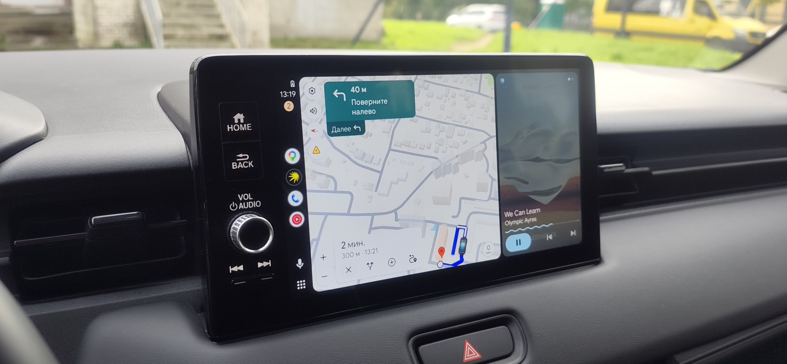

# Headswap

**English.** Headswap is an Android app that runs Android Auto on head units that only support Baidu CarLife 2.0 over USB (common on Chinese-market cars). The phone talks to Android Auto's "head unit server" on 127.0.0.1:5277 as if it were a head unit, re-encodes the 1280x720 video, and presents itself to the car as a CarLife phone over USB (AOA). Touch is mapped 1:1, audio and microphone go over USB. No dongles. Verified on a 2024 Honda Vezel. Unofficial, not affiliated with Google, Baidu or Honda. GPL-3.0.



## Что это и зачем

На многих машинах китайского рынка в штатной ГУ есть только Baidu CarLife, а Android Auto нет. Обычно это лечат донглами или заменой ГУ. Headswap обходится без них: приложение на самом телефоне делает Android Auto «головным устройством» для самого себя и перекладывает картинку и управление в CarLife, который ГУ понимает.

## Как работает

```
телефон:  Android Auto  <->  Headswap  <->  USB (AOA, CarLife 2.0)  <->  ГУ с CarLife
          (сервер ГУ,         (мост)
           127.0.0.1:5277)
```

- Приложение подключается к «серверу головного устройства» Android Auto (режим разработчика AA) по TCP как head unit: версия, TLS, сервисы, видео H.264 1280x720.
- Для ГУ оно выступает телефоном CarLife: переключается в USB-аксессуар (AOA), проходит рукопожатие CarLife 2.0 и отдаёт видео в канал VIDEO.
- Видео перекодируется, кадр повторяется каждые 100 мс. Без этого ГУ рвёт USB на статичном экране.
- Касания идут 1:1: координаты ГУ пересчитываются в кадр 1280x720 и уходят в AA как тач-события.
- Звук AA и микрофон машины идут по USB (каналы CarLife), не по Bluetooth.
- Сервер ГУ в Android Auto запускается автоматически службой спецвозможностей: приложение само открывает настройки AA и нажимает нужный пункт меню.

## Совместимость

Подтверждённые автомобили (штатные китайские ГУ с Baidu CarLife):

1. Honda Vezel 2022–2024
2. Toyota Corolla Cross 2025
3. Jetta VS7 — только с Baidu CarLife (версия с J-Link не поддерживается)
4. Mazda CX-5
5. Volkswagen Tharu XR 2026

Отчёты о других машинах приветствуются (Telegram и 4PDA ниже). Минимальная версия Android: 10 (API 29).

## Установка (для пользователей)

1. Скачайте APK: https://yegorkapomidorka.com/headswap/
2. В Android Auto включите режим разработчика (Настройки -> 10 тапов по «Версия») и в меню «три точки» пункт «Сервер головного устройства» (Start head unit server).
3. В настройках Android -> Спецвозможности включите службу Headswap. Она нужна для автозапуска сервера ГУ. Если пункт серый: Настройки -> Приложения -> Headswap -> «Разрешить ограниченные настройки».
4. Разблокируйте телефон и подключите его к ГУ по USB.

## Сборка из исходников

Нужен JDK 17.

```
cd android
./gradlew assembleDebug
```

Release-подпись читается из `~/.android-keys/headswap-release.properties` (`storeFile`, `storePassword`, `keyAlias`, `keyPassword`). Без этого файла собирается только debug.

### Сертификат head unit

Приложение не содержит сертификат в репозитории. Android Auto принимает от head unit только сертификат, подписанный Google Automotive Link. Публичные сертификат и ключ, которые используются в открытых проектах, лежат в:

- [opencardev/aasdk](https://github.com/opencardev/aasdk) (продолжение [f1xpl/aasdk](https://github.com/f1xpl/aasdk)): JVC Kenwood, `src/Messenger/Cryptor.cpp` (строки 253-299), он же в `cert/headunit.crt` и `cert/headunit.key`;
- [andreknieriem/headunit-revived](https://github.com/andreknieriem/headunit-revived): `app/src/main/res/raw/cert` и `privkey`.

Положите PEM-файлы так:

```
android/app/src/main/assets/aa/jvc/cert.pem
android/app/src/main/assets/aa/jvc/key.pem
```

и/или (набор из headunit-revived)

```
android/app/src/main/assets/aa/hur/cert.pem
android/app/src/main/assets/aa/hur/key.pem
```

Для эмулятора на ПК то же самое в `pc-headunit/certs/jvc/` (и `hur/`). `*.pem` и `*.key` в `.gitignore`.

## Структура репозитория

- `android/`: приложение (Kotlin, пакет `com.yegorkapomidorka.headswap`): мост AA <-> CarLife (`BridgeService`, `CarLifeSession`, `CarLifeState`, `AppLog`), клиент AA (`aa/`), автозапуск сервера ГУ (`autosrv/`), интерфейс (`ui/`).
- `pc-headunit/`: эмулятор ГУ Android Auto на Python для отладки на ПК, см. [pc-headunit/README.md](pc-headunit/README.md).
- `docs/`: спецификации протоколов: [aa-headunit.md](docs/aa-headunit.md) (Android Auto со стороны ГУ), [carlife-protocol.md](docs/carlife-protocol.md) (CarLife по AOA), [carlife-v2-handshake.md](docs/carlife-v2-handshake.md) (рукопожатие CarLife 2.0).

## Ограничения

- Звонки только через Bluetooth HFP: по USB они не идут.
- Для автозапуска сервера ГУ телефон должен быть разблокирован.
- HyperOS запрещает `adb input`, поэтому часть отладочных приёмов недоступна.
- Протокол CarLife 2.0 реализован ровно настолько, насколько его требует проверенная ГУ (без аутентификации и шифрования). ГУ, которые их требуют, не заработают.
- Android Auto может в любой момент поменять поведение сервера ГУ: это недокументированный режим разработчика.

## Ссылки

- Сайт и APK: https://yegorkapomidorka.com/headswap/
- Telegram: https://t.me/headswap
- Тема на 4PDA: https://4pda.to/forum/index.php?showtopic=1127415

## Дисклеймер

Неофициальный проект. Не связан с Google, Baidu и Honda; Android Auto, CarLife и Honda являются товарными знаками их владельцев. Используйте на свой риск. Не отвлекайтесь за рулём.

## Лицензия

GNU GPL v3.0, см. [LICENSE](LICENSE). © 2026 Yegor (yegorkapomidorka).

Исключение: `pc-headunit/proto/*.proto` основаны на определениях протокола из [headunit-revived](https://github.com/andreknieriem/headunit-revived) (AGPL-3.0). Всё остальное - GPL-3.0.
